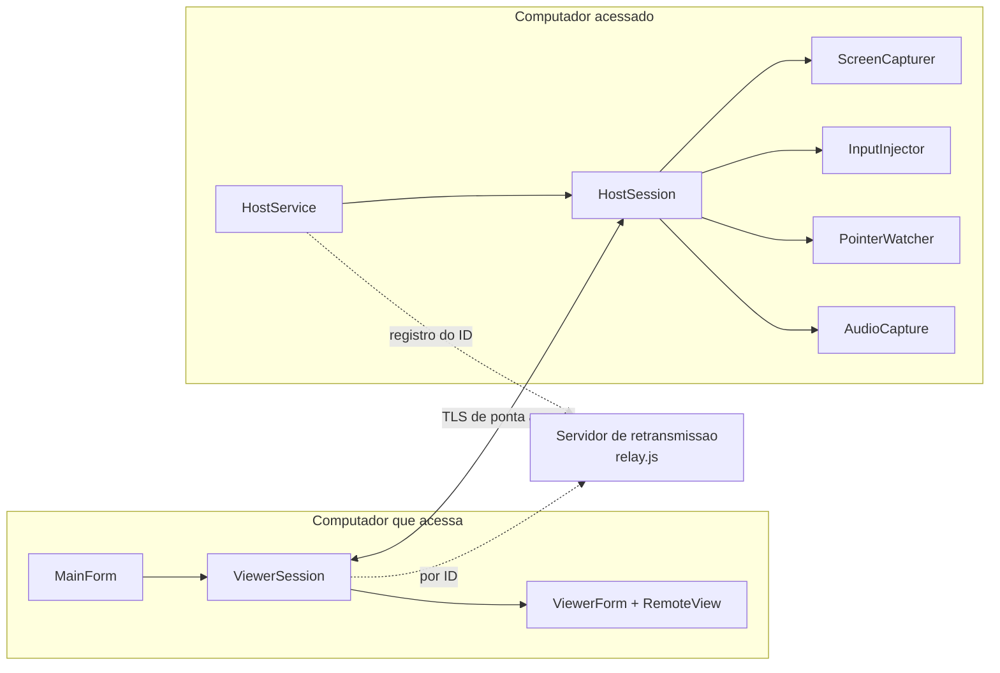
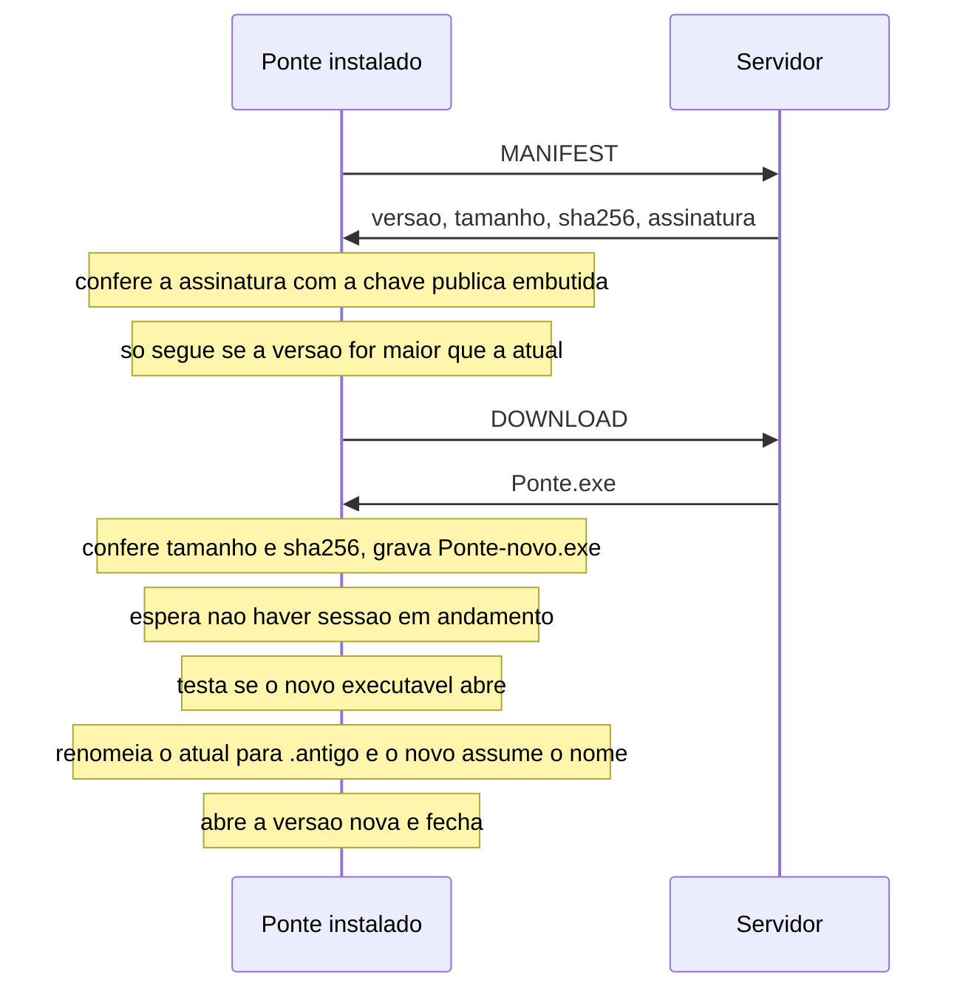

# Arquitetura e código

Este documento explica como o Ponte 1.5.1 para Windows é organizado por dentro: os arquivos, o que cada parte
faz e como elas conversam. O formato exato do que trafega na rede está em
[protocolo.md](protocolo.md); as garantias e os limites de segurança, em [seguranca.md](seguranca.md).
O aplicativo Android tem a organização dele descrita em [android.md](android.md).

Termos: **visualizador** é o computador que acessa; **controlado** é o que é acessado.

## 1. Visão geral

- Linguagem e plataforma: C# sobre .NET 10, interface em Windows Forms, só Windows de 64 bits.
- Sem pacotes externos: tudo usa a biblioteca padrão do .NET e chamadas diretas ao Windows.
- Um único executável faz os dois papéis. Ao abrir, ele já fica pronto para ser acessado e mostra a
  janela de onde se acessa outro computador.
- Roda inteiro em modo usuário. Não instala serviço nem driver.
- O servidor de retransmissão é um programa separado, em Node.js, sem dependências (`relay/relay.js`).



## 2. Mapa dos arquivos

| Arquivo | Responsabilidade |
|---|---|
| `Program.cs` | Ponto de entrada: argumentos, elevação, instância única, modos de verificação. |
| `Autostart.cs` | Início minimizado após o login, pela chave Run do usuário; desativável nas configurações. |
| `MainForm.cs` | Janela principal: endereço deste computador, conexão, listas, atualização. |
| `ComputerList.cs` | A lista de computadores salvos e recentes, com a miniatura da tela de cada um. |
| `Dialogs.cs` | Janelas menores (pedido de conexão, senhas, salvar computador, autorizados, configurações, aviso de sessão) e utilitários de interface (`Ui`). |
| `ViewerForm.cs` | Janela da sessão (`ViewerForm`) e a área que mostra a tela remota e captura mouse e teclado (`RemoteView`). |
| `ViewerSession.cs` | Lado visualizador de uma sessão: conecta, autentica, recebe quadros, envia entrada. |
| `HostService.cs` | Lado controlado: escuta, registra o ID, autentica quem chega (`HostService`) e conduz a sessão (`HostSession`). |
| `ScreenCapturer.cs` | Captura da tela com envio só do que mudou (`ScreenCapturer`) e reprodução de mouse e teclado (`InputInjector`). |
| `Pointer.cs` | O ponteiro do mouse: leitura da forma no controlado (`PointerWatcher`) e uso dela na janela da sessão (`RemotePointer`). |
| `Audio.cs` | O som: formato e compressão (`AudioCodec`), captura no controlado (`AudioCapture`) e reprodução no visualizador (`AudioPlayer`). |
| `FileTransfer.cs` | Envio (`FileSender`) e recebimento (`FileReceiver`) de arquivos. |
| `Protocol.cs` | Tipos de mensagem, registros JSON e o enquadramento sobre o fluxo cifrado (`Channel`). |
| `Transport.cs` | Como chegar ao outro computador: TCP direto ou servidor de retransmissão, e o TLS. |
| `Security.cs` | Chaves, ID, provas de senha e de autorização (`Security`); configuração do usuário (`AppConfig`). |
| `Updater.cs` | Atualização automática: checar, baixar, conferir assinatura, trocar o executável. |
| `UpdateKey.cs` | Chave pública que confere a assinatura das atualizações. |
| `RelayDefaults.cs` | Servidor e chave de retransmissão padrão. Fica fora do git; há um modelo em `RelayDefaults.cs.exemplo`. |
| `Elevation.cs` | Detecta e pede a execução como administrador. |
| `Native.cs` | Declarações das funções do Windows usadas: entrada e ponteiro (`user32.dll`, `gdi32.dll`), reprodução de som (`winmm.dll`) e captura de som (interfaces COM do WASAPI). |
| `SelfTest.cs` | Autoteste de ponta a ponta numa máquina só. |
| `relay/relay.js` | Servidor de retransmissão e de arquivos de atualização. |
| `relay/ponte-relay.service` | Unidade do systemd para o servidor. |
| `publicar.ps1` | Gera, testa, assina e publica uma versão. |
| `android/` | O aplicativo Android, um projeto à parte. Veja [android.md](android.md). |

## 3. Partida do programa

`Program.Main` segue esta ordem:

0. Escolhe o tema das janelas (`Ui.ApplyTheme`), que precisa valer antes de a primeira existir. O
   tema vem de `--tema` ou do campo `Theme` da configuração, lido sozinho (`AppConfig.SavedTheme`),
   sem carregar nem criar o resto.
1. `--verificar` sai com código 0. É o "teste de partida" que a atualização usa para saber se um
   executável novo abre.
2. Ferramentas de publicação (`--gerar-chave-atualizacao`, `--assinar-atualizacao`) executam e saem.
3. **Elevação.** Se o processo não está como administrador e não recebeu `--ja-elevou` nem
   `--sem-elevar`, ele se reabre elevado quando há `--elevar`, ou quando a configuração pede
   (`RunElevated`) e a conta é de administrador ainda não elevada. Os modos de verificação só
   elevam com `--elevar` explícito.
4. Modos que não abrem a janela principal: `--pos-atualizacao`, `--atualizar-agora`,
   `--janela-teste`, `--autoteste`, `--demo`.
5. Carrega a configuração (`AppConfig.Load`).
6. **Instância única.** Um mutex com nome derivado da pasta de configuração impede duas cópias no
   mesmo perfil, que disputariam a porta e o registro do ID. Depois de uma atualização ou de uma
   reabertura como administrador, a cópia nova espera até 15 segundos a anterior fechar.
7. Limpa sobras de atualização, inicia o `HostService` e abre a `MainForm`.

### Argumentos de linha de comando

| Argumento | Efeito |
|---|---|
| `--perfil pasta` | Usa outra pasta de configuração, com outro ID. |
| `--elevar` | Abre como administrador mesmo que a configuração diga que não. |
| `--sem-elevar` | Não tenta abrir como administrador. |
| `--tema claro\|escuro` | Usa esse tema nesta execução, sem mudar a configuração. |
| `--autoteste pasta [--relay host:porta]` | Testa os dois lados nesta máquina e grava `autoteste.txt` na pasta. |
| `--captura-ui pasta` | Grava imagens da janela principal e das secundárias e sai. |
| `--demo pasta` | Abre uma sessão com a própria máquina, grava a imagem da janela e sai. |
| `--janela-teste segundos` | Mostra uma janela em primeiro plano por 5 a 300 segundos. Com `--elevar`, reproduz um programa de administrador em primeiro plano. |
| `--atualizar-agora log [--relay host:porta]` | Procura, confere e instala a atualização sem abrir janela, registrando no arquivo. |
| `--gerar-chave-atualizacao chave fonte.cs` | Cria o par de chaves de assinatura. Não sobrescreve uma chave existente. |
| `--assinar-atualizacao exe chave manifesto` | Assina um executável e grava o manifesto. |

Uso interno, passados pelo próprio programa ao se reabrir: `--ja-elevou`, `--aguardar`,
`--atualizado`, `--pos-atualizacao log`, `--verificar`.

Em `--autoteste`, `--demo` e `--captura-ui`, que rodam sem ninguém olhando, um erro inesperado não
abre janela de aviso: é gravado em `erro.txt` na pasta indicada e o processo sai com código 3.

## 4. Lado controlado

### HostService

Criado na partida, fica ativo enquanto o programa estiver aberto.

- **Conexões diretas:** escuta em todas as interfaces na porta configurada (padrão 7411). Se a
  porta estiver ocupada, as conexões diretas ficam desativadas e o resto continua.
- **Registro do ID:** mantém uma conexão de controle com o servidor de retransmissão. Se ela cai,
  tenta de novo a cada 5 segundos. Cada pedido de conexão (`INCOMING`) vira uma conexão nova ao servidor.
- **Atendimento (`HandleAsync`):** para cada conexão que chega faz o TLS, lê o `Hello`, manda o
  desafio, recebe a resposta e decide. A ordem da decisão é: autorização salva, senha, aceite na
  tela. O pedido na tela é delegado à `MainForm` pela função `AskPermission`.
- **Uma sessão por vez:** a sessão aceita ocupa o campo `_current`; uma segunda é recusada.
- **Senhas erradas:** cinco seguidas suspendem o acesso por senha por dez minutos.

### HostSession

Uma sessão em andamento tem três laços:

- **Captura:** a cada ciclo chama `ScreenCapturer.Capture` e envia o quadro se algo mudou. O ciclo
  mira 50 ms, então o teto é de cerca de 20 quadros por segundo. Se a captura falha (tela bloqueada,
  aviso do Windows pedindo confirmação), espera meio segundo e tenta de novo, mandando a tela
  inteira quando voltar. No mesmo ciclo consulta o ponteiro do mouse e envia a forma (`Cursor`) e a
  posição (`CursorPos`) quando elas mudam.
- **Leitura:** aplica mouse e teclado, recebe arquivos e área de transferência, troca de monitor e
  de qualidade, e liga ou desliga o som.
- **Som:** envia os pedaços que a captura de som põe numa fila de até 50 (1 segundo). Com a fila
  cheia, o pedaço mais antigo é descartado.

Ao terminar, por qualquer motivo, para a captura de som e solta todas as teclas que tenham ficado
pressionadas.

### Ponteiro do mouse

`PointerWatcher.Poll` pergunta ao Windows qual é o ponteiro atual (`GetCursorInfo`) e só faz alguma
coisa quando ele é outro. O Windows não entrega a imagem do ponteiro com transparência pronta, e
alguns pontos dela não têm cor: invertem a do que está embaixo. Por isso `Encode` desenha o ponteiro
duas vezes (`DrawIconEx`), numa superfície toda preta e numa toda branca, e compara os resultados
ponto a ponto:

- iguais nos dois: ponto opaco, daquela cor;
- preto num e branco no outro, na ordem dos fundos: ponto transparente;
- no meio do caminho: parcialmente transparente (bordas suaves e sombra), e a diferença dá a opacidade;
- mais claro sobre o preto que sobre o branco: ponto que inverte. Vira preto, e os pontos
  transparentes em volta viram brancos, para ele aparecer sobre qualquer fundo.

As duas superfícies são criadas direto no Windows (`CreateDIBSection`). Desenhar por cima de um
`Bitmap` do .NET não serve: o Windows receberia uma superfície zerada, e não o fundo pintado.

### Som

`AudioCapture` roda numa thread própria e usa o WASAPI em modo "loopback", que entrega o que está
saindo pela saída de som padrão, já misturado. Não abre o microfone.

1. Pede o som em 48 kHz, 16 bits, estéreo, com o Windows convertendo. Se ele recusar, captura no
   formato da mixagem e converte aqui (ponto flutuante ou inteiro, qualquer número de canais).
2. A cada 10 ms recolhe o que chegou e corta em pedaços de 20 ms.
3. Um pedaço em silêncio ainda é enviado até completar 200 ms; depois disso, nada sai até voltar o som.
4. Cada pedaço é codificado por `AudioCodec.Encode`, em PCM ou ADPCM conforme a qualidade.
5. Se a saída de som some ou muda (um fone conectado), a captura recomeça com a que for a padrão.
   `Problem` guarda o motivo enquanto não há captura, e o aviso de sessão ativa o mostra.

### Captura de tela

`ScreenCapturer` copia a tela com GDI (`Graphics.CopyFromScreen`) para um bitmap de 32 bits e
compara com a captura anterior:

1. A imagem é dividida em blocos de 64 × 64 pixels; cada bloco é comparado linha a linha.
2. Sem bloco alterado, nada é enviado.
3. Com mais de 60 % dos blocos alterados, vai a tela inteira num JPEG só, que sai menor e mais
   rápido que dezenas de pedaços.
4. Senão, blocos vizinhos são unidos em retângulos (primeiro em faixas horizontais, depois
   estendendo cada faixa para baixo) e cada retângulo vira um JPEG.

A qualidade do JPEG vem do visualizador (35, 60 ou 85 na interface; o padrão é 60). A captura atual
e a anterior ficam em dois bitmaps que trocam de papel a cada ciclo, em vez de se criar um novo a cada vez.

### Mouse e teclado

`InputInjector` usa a função `SendInput` do Windows.

- **Mouse:** a posição chega de 0 a 65535 dentro do monitor escolhido. Ela é convertida para pixels
  desse monitor, arredondando, e depois para a escala da área de trabalho virtual, que cobre todos os
  monitores. O `SendInput` também quer a posição de 0 a 65535 e a converte de volta truncando; a
  conta mira no meio do pixel para o resultado cair no pixel pedido, e não no vizinho.
- **Teclado:** chega o código de tecla virtual; o código de varredura é obtido com `MapVirtualKey`.
- **Texto:** a mensagem `Text`, usada pelo aplicativo Android, traz texto pronto. Cada caractere é
  injetado como entrada Unicode, que não depende do layout de teclado; Enter e Tab vão como teclas.
- **Bloqueio do Windows:** quando `SendInput` devolve zero, o Windows recusou a entrada. Isso
  acontece quando a janela ativa é de um programa de administrador e o Ponte não é. A sessão então
  manda um `Notice` ao visualizador, no máximo a cada 8 segundos.

## 5. Lado visualizador

### ViewerSession

`ConnectAsync` faz a conexão e a autenticação e devolve a sessão pronta:

1. `Transport.ConnectAsync` abre o TCP (direto ou pelo servidor) e o TLS, e confere o ID.
2. Compara a impressão digital do certificado com a guardada em `KnownHosts`. Se mudou, pergunta
   ao usuário.
3. Envia o `Hello`, recebe o desafio e assina.
4. Se o controlado tem senha e não reconhece este computador, pede a senha ao usuário.
5. Envia a resposta e espera o resultado.
6. Registra a conexão: identidade vista, lista de recentes e, se o computador está salvo, se ele
   está autorizado.

Depois de `Start`, um laço de leitura aplica os quadros na imagem `Canvas` e dispara eventos para
arquivos, área de transferência, avisos, ponteiro (`PointerChanged`) e som (`SoundReceived`, já
decodificado). Quem lê ou desenha `Canvas` segura `CanvasLock`.

`SaveThumbnail` grava uma redução de `Canvas` (320 × 180, JPEG), que é a miniatura mostrada na lista
de computadores.

### ViewerForm e RemoteView

- `RemoteView` desenha `Canvas` ajustado à janela, mantendo a proporção. Vários quadros seguidos
  viram uma repintura só.
- A posição do mouse na janela vira primeiro o pixel da tela remota que está debaixo do ponteiro e
  depois a escala de 0 a 65535 da mensagem, arredondada (`RemoteView.ToRemote`). Movimentos são
  enviados no máximo a cada 12 ms; o último de uma sequência nunca se perde, porque um temporizador
  envia o que ficou para trás.
- O ponteiro do outro computador vira o ponteiro da área (`SetPointer`): a imagem recebida é
  transformada num ponteiro do Windows com o mesmo ponto ativo (`RemotePointer`).
- As teclas são interceptadas antes do Windows Forms (`PreProcessMessage`), para que Tab, Alt e F4
  também sigam para o outro computador. Ao perder o foco, a janela manda soltar as teclas que
  estavam pressionadas.
- `ViewerForm` tem a barra de comandos (monitor, qualidade, teclas especiais, tela cheia, arquivo,
  imagem, área de transferência, som) e a barra de estado com quadros por segundo e consumo de rede.
- O som é tocado por `AudioPlayer` (`waveOut`). Ele guarda 150 ms de folga antes de começar, para
  os pedaços que a rede atrasa não virarem falhas, e descarta o que chega quando já tem mais de
  600 ms esperando. Com os dois lados na mesma máquina o som fica desligado: o que fosse tocado
  seria capturado de novo.
- A miniatura é gravada logo que a primeira imagem chega, de minuto em minuto e ao fechar a janela.

## 6. Janela principal

`MainForm` junta os dois lados:

- Mostra o ID, os IPs locais e a situação do servidor.
- Recebe os eventos do `HostService` (sessão começou, terminou, arquivo chegou) e mostra o aviso de
  sessão ativa (`SessionIndicator`).
- Responde aos pedidos de conexão com a janela `AcceptDialog`.
- Monta a lista de computadores salvos e recentes (`ComputerList`). Um computador salvo não aparece
  de novo entre os recentes. A lista é desenhada pelo próprio Ponte, para sair igual no tema claro
  e no escuro: título de grupo, miniatura e três linhas de texto por computador.
- Observa a área de transferência do Windows (`WM_CLIPBOARDUPDATE`) e repassa o texto à sessão em
  que este computador é controlado e às janelas de sessão com a opção ligada. O texto que acabou de
  chegar do outro lado não é devolvido.
- Cuida da atualização automática.

## 7. Configuração

`AppConfig` é gravada em `%APPDATA%\Ponte\config.json` (ou na pasta de `--perfil`). A gravação é
feita num arquivo temporário e depois movida, para não deixar um arquivo pela metade.

| Campo | Conteúdo |
|---|---|
| `CertPfx` | Certificado e chave privada do computador, cifrados com DPAPI para a conta do Windows. |
| `PasswordSalt`, `PasswordVerifier`, `Iterations` | Derivado da senha de acesso (PBKDF2). A senha em si não é guardada. Vazios quando não há senha. |
| `RelayServer`, `RelayKey` | Servidor de retransmissão e chave de acesso. |
| `ListenPort`, `DirectEnabled` | Porta e liga/desliga das conexões diretas. |
| `RunElevated` | Abrir como administrador quando a conta permitir. Padrão: sim. |
| `AutoUpdate` | Atualização automática. Padrão: sim. |
| `Theme` | `auto` (acompanha o Windows), `claro` ou `escuro`. Padrão: `auto`. |
| `ShareSound` | Quem acessa este computador pode ouvir o som dele. Padrão: sim. |
| `PlaySound` | Ao acessar outro computador, tocar aqui o som de lá. Padrão: sim. |
| `Recent` | Até 12 conexões recentes: endereço, nome e data. |
| `Saved` | Computadores salvos: chave do destino, endereço, nome, `AutoAccess` (pedir entrada direta), `Paired` (o outro lado confirmou a autorização na última conexão) e último uso. |
| `Trusted` | Computadores autorizados a entrar direto: resumo da chave, ID, nome, usuário, datas e `ViaPassword` (autorizado por senha, e não por aceite). Até 50. |
| `KnownHosts` | Impressão digital do certificado visto em cada destino (`id:123456789` ou `ip:endereço`). |

As miniaturas ficam na subpasta `miniaturas`, uma por destino, com o nome derivado da chave do
destino. São apagadas quando o computador sai da lista de salvos e de recentes.

### Tema

O modo noturno usa o suporte do próprio Windows Forms (`Application.SetColorMode`): com ele as cores
do sistema (`SystemColors`) passam a ser as escuras e os controles se desenham de acordo. As poucas
cores próprias do Ponte passam por `Ui.Accent` e `Ui.Danger`, que clareiam no tema escuro.

Casos de borda no carregamento:

- JSON inválido: o arquivo é copiado para `config.json.invalido` e a configuração recomeça.
- Chave que esta conta não consegue abrir (perfil copiado de outro usuário): o arquivo é copiado
  para `config.json.outra-conta` e nasce um ID novo.

## 8. Concorrência

| Recurso | Quem usa | Proteção |
|---|---|---|
| Listas da configuração e gravação do arquivo | Janela (thread da interface) e atendimento de conexões (threads do pool) | Trava interna da `AppConfig`; todo método que altera ou grava passa por ela. |
| Escrita no canal | Laço de captura, laço de som, envio de arquivo, área de transferência | `Channel` tem um semáforo de escrita; uma mensagem nunca se mistura com outra. |
| Som capturado | Thread da captura (produz) e laço de som (envia) | Fila limitada, que descarta o mais antigo quando enche. |
| Saída de som | Laço de leitura (toca) e fechamento da janela (encerra) | Trava interna do `AudioPlayer`. |
| Envio de arquivo | Dois envios pedidos ao mesmo tempo | `Channel.FileLock`: um arquivo por vez em cada sentido. |
| Imagem da tela remota | Laço de leitura (grava) e pintura da janela (lê) | `ViewerSession.CanvasLock`. |
| Controles da interface | Eventos vindos de outras threads | Sempre via `BeginInvoke` (`Post`). |

## 9. Atualização automática



- A checagem roda 15 segundos depois de a janela abrir e depois a cada 30 minutos, se a
  atualização automática estiver ligada.
- Só o executável de arquivo único se atualiza. A versão de desenvolvimento, que tem `Ponte.dll`
  ao lado, não tenta.
- O Windows não deixa sobrescrever um programa em execução, mas deixa renomeá-lo. Por isso o
  executável atual vira `Ponte.exe.antigo` e o novo assume o nome. Se a troca falha, o nome
  original é restaurado.
- O arquivo baixado é conferido de novo imediatamente antes de ser executado.
- A versão nova abre com os mesmos argumentos, mais `--atualizado`, e apaga as sobras na partida.
- Uma cópia nunca instala uma versão menor ou igual à que está em uso.

O manifesto assinado e as garantias dessa assinatura estão descritos em [seguranca.md](seguranca.md).

## 10. Elevação

`Elevation` consulta o tipo de elevação do token do processo:

- `IsElevated`: o processo já é administrador.
- `CanElevateSameUser`: a conta é de administrador, mas o processo não está elevado. Nesse caso o
  Windows eleva com uma confirmação simples, sem pedir a senha de outra conta.

A reabertura usa o verbo `runas`, que é o caminho normal do UAC. Nada é contornado: se o usuário
recusa, o Ponte segue sem administrador.

## 11. Autoteste

`--autoteste` sobe o lado controlado em `127.0.0.1` e conecta o lado visualizador no mesmo
processo, com perfis descartáveis. Com `--relay`, o caminho passa pelo servidor e a conexão é feita
pelo ID. O resultado vai para `autoteste.txt`, uma linha por verificação:

- registro do ID no servidor (só com `--relay`);
- senha errada recusada; pedido recusado na tela não entra; pedido aceito entra;
- aceite simples não deixa o computador autorizado;
- senha correta entra; primeira imagem recebida; imagem do tamanho da tela;
- segunda sessão simultânea recusada;
- a forma do ponteiro do mouse chega ao visualizador; os ponteiros de texto, mão, redimensionar e
  cruz viram imagem;
- a miniatura da tela é gravada;
- mouse remoto move o cursor; tecla remota pressiona e solta;
- o mouse remoto cai no pixel exato, com a imagem em tamanho real e reduzida;
- o som comprimido volta parecido com o original e o sem compressão volta idêntico;
- o som do computador chega ao visualizador, e para quando ele o dispensa;
- texto remoto é digitado caractere a caractere, com acento, símbolo, emoji e Enter;
- arquivo nos dois sentidos, com conteúdo idêntico;
- texto da área de transferência chega ao outro lado;
- a sessão termina no controlado;
- entrar com a senha sem estar salvo não autoriza;
- visualizador de versão anterior ainda entra com a senha;
- computador salvo que entra com a senha fica autorizado, e depois entra sem senha e sem aceite;
- outro computador continua precisando de aceite;
- chave pública alheia sem a chave privada não entra;
- autorização removida deixa de valer;
- "sempre permitir" no aceite autoriza as conexões seguintes.

Cada linha também vai, na hora, para `andamento.txt`; se o teste travar, é ali que se vê onde.

O teste move o cursor de verdade (e o devolve ao lugar), usa a tecla F24, que não existe em teclado
comum, e não toca na área de transferência real. Para o som, toca por um instante um tom grave e
muito baixo; se o computador não tem saída de som, ou ela está muda, a verificação sai como "NÃO
VERIFICADO". Para conferir o texto digitado sem digitar no
programa que a pessoa estiver usando, ele instala por um instante um gancho de teclado que observa
as teclas injetadas e as retém; o que a pessoa digitar de verdade nesse instante passa normalmente. Se houver uma janela de administrador em primeiro
plano, as verificações de mouse e teclado saem como "NÃO VERIFICADO", e o teste confere apenas se o
visualizador foi avisado do bloqueio.

O processo sai com código 0 quando tudo passa e 1 quando há falha.

## 12. Compilação

O projeto (`Ponte.csproj`) é um executável Windows Forms para `net10.0-windows`, com tipos anuláveis
ligados e código `unsafe` permitido (usado na comparação de blocos da captura, na imagem do
ponteiro e nas amostras de som).

```
dotnet build -c Release
```

O executável distribuído é de arquivo único e depende do .NET Desktop Runtime 10 instalado:

```
dotnet publish -c Release -r win-x64 --self-contained false -p:PublishSingleFile=true -p:DebugType=none -p:DebugSymbols=false
```

Na prática quem gera o executável distribuído é o `publicar.ps1`, descrito em [operacao.md](operacao.md).
