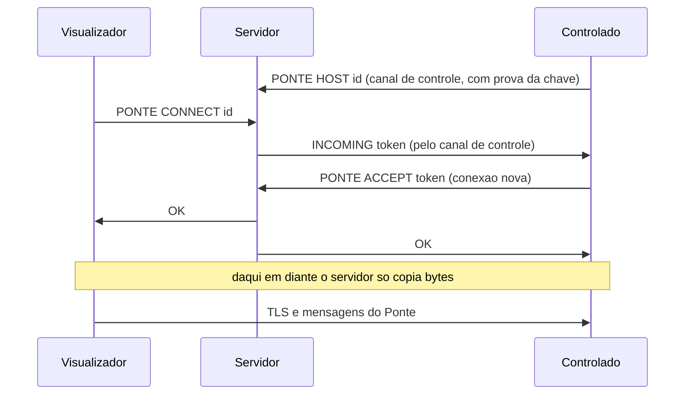
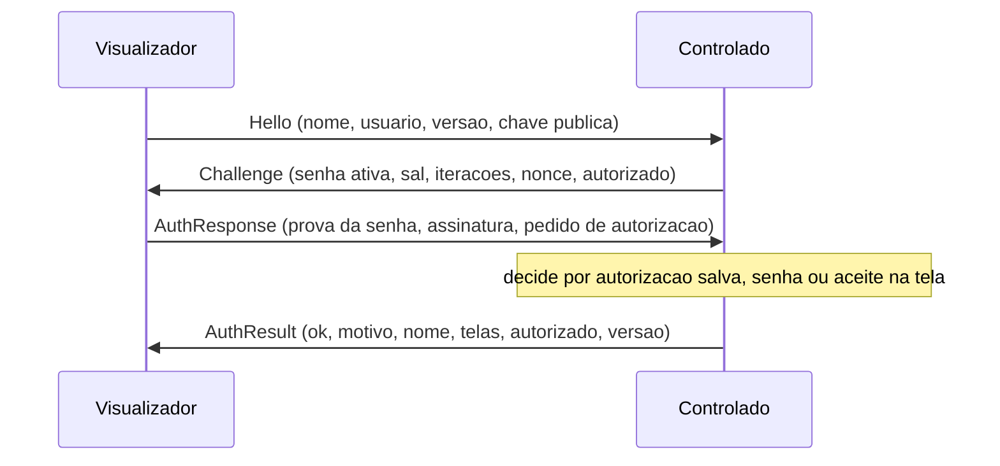
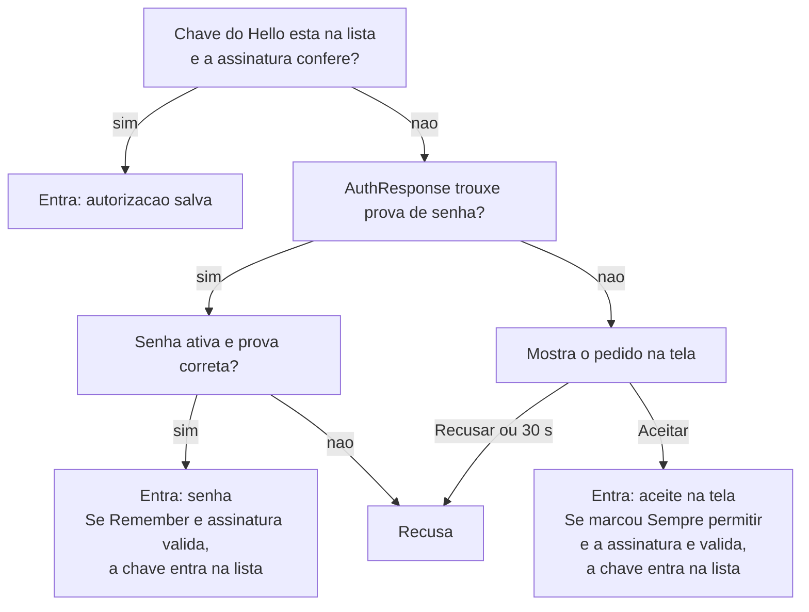

# Protocolo de rede

Este documento descreve o que trafega entre dois computadores com o Ponte e entre eles e o servidor
de retransmissão. Vale para a versão 1.5.1. O código de referência está em `Transport.cs`,
`Protocol.cs`, `HostService.cs`, `ViewerSession.cs` e `relay/relay.js`. O aplicativo Android fala
o mesmo protocolo; o código dele está em `android/core`.

Termos usados aqui: **visualizador** é o computador que acessa; **controlado** é o que é acessado.

## 1. Camadas

```
mensagens do Ponte (tipo + tamanho + conteúdo)
TLS 1.2 ou 1.3, de ponta a ponta entre os dois computadores
[só por ID] uma linha de texto para o servidor de retransmissão, que depois só repassa bytes
TCP
```

Há dois caminhos para chegar ao TLS:

- **Direto:** o visualizador abre TCP na porta do controlado (padrão 7411) e começa o TLS.
- **Por ID:** os dois abrem conexões de saída para o servidor de retransmissão (padrão 7412), que
  junta as duas e passa a copiar os bytes de uma para a outra. O TLS começa depois disso e é
  negociado entre os dois computadores, não com o servidor.

## 2. Servidor de retransmissão

### 2.1 Primeira linha

Toda conexão ao servidor começa com uma linha de texto ASCII terminada em `\n`:

```
PONTE <COMANDO> <argumento> [chave]
```

| Comando | Argumento | Quem envia | Finalidade |
|---|---|---|---|
| `HOST` | ID de 9 dígitos | controlado | Registrar-se como alcançável por aquele ID. |
| `CONNECT` | ID de 9 dígitos | visualizador | Pedir conexão ao computador com aquele ID. |
| `ACCEPT` | token de 32 dígitos hexadecimais | controlado | Atender um pedido, numa conexão nova. |
| `MANIFEST` | `0` | qualquer cópia | Baixar o manifesto da atualização. |
| `DOWNLOAD` | `0` | qualquer cópia | Baixar o executável da atualização. |

A linha precisa casar com a expressão
`^PONTE (HOST|CONNECT|ACCEPT|MANIFEST|DOWNLOAD) ([0-9a-f]{1,64})(?: ([A-Za-z0-9_-]{1,128}))?$`;
qualquer outra coisa derruba a conexão. Se o servidor foi iniciado com `PONTE_KEY`, a chave é
obrigatória em todos os comandos, e uma chave errada recebe `ERR key`.

Respostas de erro têm a forma `ERR <motivo>`:

| Resposta | Significado |
|---|---|
| `ERR key` | Chave de acesso ausente ou errada. |
| `ERR proof` | O computador não provou ser dono do ID que tentou registrar. |
| `ERR offline` | Não há computador registrado com aquele ID. |
| `ERR busy` | Há pedidos demais aguardando atendimento. |
| `ERR timeout` | O computador chamado não atendeu em 20 segundos. |
| `ERR token` | Token de atendimento desconhecido ou já usado. |
| `ERR none` | Não há arquivo de atualização para entregar. |

### 2.2 Registro do controlado

```
controlado → PONTE HOST 460087520 <chave>
servidor   → NONCE <64 dígitos hexadecimais>
controlado → PROOF <chave pública SPKI em base64> <assinatura em base64>
servidor   → OK
```

A assinatura é ECDSA P-256 com SHA-256 sobre os 32 bytes do `NONCE`, no formato IEEE P1363 (`r`
seguido de `s`). O servidor só aceita se a assinatura conferir **e** se o ID calculado a partir da
chave pública enviada for o ID pedido. Um registro novo do mesmo ID derruba o anterior.

Depois do `OK` a conexão fica aberta como canal de controle:

- O controlado manda `PING` a cada 25 segundos e o servidor responde `PONG`.
- O controlado desiste da conexão se passar 70 segundos sem `PONG` e registra-se de novo.
- O servidor remove um registro que fique 90 segundos sem atividade.
- Quando alguém pede conexão, o servidor manda `INCOMING <token>` por esse canal.

### 2.3 Conexão por ID



O que cada lado tiver enviado logo depois da própria linha é repassado ao outro quando as conexões
são unidas. Quando uma das duas fecha, o servidor fecha a outra.

### 2.4 Arquivos de atualização

```
cópia    → PONTE MANIFEST 0 <chave>
servidor → OK <tamanho em bytes>
servidor → <tamanho> bytes e fim da conexão
```

`MANIFEST` entrega `manifest.json` (até 8 KiB) e `DOWNLOAD` entrega `Ponte.exe` (até 64 MiB), ambos
da pasta de atualização do servidor. Sem TLS: a proteção é a assinatura conferida pelo programa
(veja [seguranca.md](seguranca.md)).

### 2.5 Limites do servidor

| Limite | Valor |
|---|---|
| Conexões simultâneas no total | 600 |
| Conexões simultâneas de um mesmo endereço | 40 |
| Prazo para a primeira linha | 15 s |
| Tamanho máximo de uma linha | 2048 bytes |
| Pedidos aguardando atendimento | 500 |
| Prazo para o controlado atender | 20 s |
| Registro sem atividade | 90 s |

## 3. TLS

- Versões aceitas: TLS 1.2 e 1.3.
- O controlado é o lado servidor do TLS e apresenta o certificado próprio: autoassinado, ECDSA
  P-256, `CN=Ponte`, válido por 30 anos, criado na primeira abertura.
- O visualizador não apresenta certificado no TLS; ele se identifica depois, por assinatura (seção 5).
- Não há autoridade certificadora. O visualizador confere a identidade assim:
  - **Por ID:** o ID calculado a partir da chave pública do certificado tem de ser o ID digitado.
  - **Sempre:** a impressão digital do certificado (SHA-256 do certificado inteiro) é guardada na
    primeira conexão. Se mudar numa conexão posterior, o usuário é avisado e decide.

### Cálculo do ID

```
resumo = SHA-256(chave pública em formato SPKI)
ID     = 100000000 + (primeiros 8 bytes do resumo, como inteiro big-endian) mod 900000000
```

O resultado tem sempre 9 dígitos. O servidor e o programa fazem a mesma conta.

## 4. Mensagens

Dentro do TLS, cada mensagem tem um cabeçalho de 5 bytes e o conteúdo:

| Posição | Tamanho | Conteúdo |
|---|---|---|
| 0 | 1 byte | tipo da mensagem |
| 1 | 4 bytes | tamanho do conteúdo, inteiro little-endian |
| 5 | variável | conteúdo |

Antes da autenticação, uma mensagem maior que 8 KiB derruba a conexão; depois dela o limite sobe
para 64 MiB. Inteiros dentro do conteúdo são little-endian.

| Tipo | Nome | Sentido | Conteúdo |
|---|---|---|---|
| 1 | Hello | visualizador → controlado | JSON |
| 2 | Challenge | controlado → visualizador | JSON |
| 3 | AuthResponse | visualizador → controlado | JSON |
| 4 | AuthResult | controlado → visualizador | JSON |
| 10 | Frame | controlado → visualizador | binário, seção 6.1 |
| 11 | Cursor | controlado → visualizador | binário, seção 6.9. *Desde a 1.5.0.* |
| 12 | Audio | controlado → visualizador | binário, seção 6.10. *Desde a 1.5.0.* |
| 13 | CursorPos | controlado → visualizador | binário, seção 6.11. *Desde a 1.5.1.* |
| 20 | Mouse | visualizador → controlado | binário, seção 6.2 |
| 21 | Key | visualizador → controlado | binário, seção 6.3 |
| 22 | Text | visualizador → controlado | texto UTF-8, seção 6.8. *Desde a 1.3.0.* |
| 30 | Clipboard | os dois | texto UTF-8 |
| 40 | FileStart | os dois | JSON |
| 41 | FileChunk | os dois | bytes do arquivo |
| 42 | FileEnd | os dois | vazio |
| 50 | Settings | visualizador → controlado | JSON |
| 60 | Notice | controlado → visualizador | texto UTF-8 |
| 99 | Bye | os dois | vazio |

Tipos desconhecidos são ignorados durante a sessão.

## 5. Autenticação



### 5.1 Campos

**Hello**

| Campo | Tipo | Conteúdo |
|---|---|---|
| `Name` | texto | Nome do computador do visualizador. |
| `User` | texto | Usuário do Windows no visualizador. |
| `Version` | texto | Versão do Ponte do visualizador. |
| `Key` | texto ou nulo | Chave pública do visualizador, SPKI em base64. *Desde a 1.2.0.* |
| `Caps` | inteiro ou nulo | O que o visualizador sabe receber, em bits (veja abaixo). *Desde a 1.5.0.* |

Bits de `Caps`, os mesmos no `Hello` e no `AuthResult`:

| Bit | Valor | No `Hello` (visualizador) | No `AuthResult` (controlado) |
|---|---|---|---|
| 0 | 1 | Grava os arquivos que chegam. | Não usado. |
| 1 | 2 | Desenha o ponteiro que chega em `Cursor`. | Envia `Cursor`. |
| 2 | 4 | Toca o som que chega em `Audio`. | Transmite o som quando pedido em `Settings`. |

Sem `Caps` no `Hello` (visualizador anterior à 1.5.0), o controlado não envia `Cursor` e trata o
visualizador como capaz de receber arquivos, a não ser que o `User` seja `Android`: o aplicativo do
celular 1.0.0 não gravava arquivos e ainda não avisava isso.

**Challenge**

| Campo | Tipo | Conteúdo |
|---|---|---|
| `HasPassword` | lógico | O controlado aceita senha agora (tem senha e não está em suspensão). |
| `Salt` | texto | Sal da senha em base64 (16 bytes). |
| `Iterations` | inteiro | Iterações do PBKDF2. O visualizador recusa valores fora de 1.000 a 2.000.000. |
| `Nonce` | texto | 32 bytes aleatórios em base64, novos a cada conexão. |
| `Trusted` | lógico | A chave enviada no Hello está na lista de autorizados. *Desde a 1.2.0.* |

**AuthResponse**

| Campo | Tipo | Conteúdo |
|---|---|---|
| `Proof` | texto ou nulo | Prova da senha em base64. Nulo significa "peça permissão na tela". |
| `Signature` | texto ou nulo | Assinatura do visualizador em base64. *Desde a 1.2.0.* |
| `Remember` | lógico | Pede para ficar autorizado ao entrar com a senha. *Desde a 1.2.0.* |

**AuthResult**

| Campo | Tipo | Conteúdo |
|---|---|---|
| `Ok` | lógico | A sessão foi aceita. |
| `Reason` | texto | Mensagem para o usuário quando `Ok` é falso. |
| `HostName` | texto | Nome do computador controlado. |
| `Screens` | lista | Monitores: `Index`, `Width`, `Height`, `Primary`. |
| `Paired` | lógico | O visualizador está na lista de autorizados. *Desde a 1.2.0.* |
| `Version` | texto | Versão do Ponte do controlado. *Desde a 1.2.1.* |
| `Caps` | inteiro | O que o controlado oferece, nos bits descritos no `Hello`. *Desde a 1.5.0.* |

### 5.2 Prova da senha

```
verificador = PBKDF2-HMAC-SHA256(senha, sal, iterações, 32 bytes)
prova       = HMAC-SHA256(chave = verificador, dados = nonce || SHA-256(certificado do controlado))
```

O visualizador usa o certificado que ele viu no TLS; o controlado usa o próprio. Se houver um
intermediário apresentando outro certificado, as duas contas dão resultados diferentes.

### 5.3 Assinatura do visualizador

```
mensagem   = "ponte-autorizacao\n" || nonce (32 bytes) || SHA-256(certificado do controlado)
assinatura = ECDSA P-256 com SHA-256 sobre a mensagem, com a chave privada do visualizador
```

O visualizador assina em toda conexão. O controlado confere a assinatura com a chave do `Hello` e
só então considera a chave "provada". Uma chave provada é identificada pelo SHA-256 inteiro do SPKI,
não pelo ID de 9 dígitos.

### 5.4 Decisão do controlado



Depois de aceita, a sessão ainda pode ser recusada com "Já existe uma sessão em andamento neste
computador", porque o controlado atende uma por vez.

### 5.5 Prazos

| Etapa | Prazo |
|---|---|
| TLS, Hello e Challenge, no controlado | 20 s |
| Espera pelo AuthResponse, no controlado (o usuário pode estar digitando a senha) | 2 min |
| Hello até Challenge, no visualizador | 20 s |
| Pedido na tela do controlado | 30 s |
| Espera pelo AuthResult, no visualizador | 75 s |

## 6. Sessão

### 6.1 Frame (tipo 10)

Cada quadro traz só as áreas da tela que mudaram.

| Campo | Tamanho | Conteúdo |
|---|---|---|
| largura | 2 bytes | largura da tela inteira, em pixels |
| altura | 2 bytes | altura da tela inteira |
| quantidade | 2 bytes | número de retângulos que seguem |

Para cada retângulo:

| Campo | Tamanho | Conteúdo |
|---|---|---|
| x, y | 2 + 2 bytes | canto superior esquerdo |
| w, h | 2 + 2 bytes | largura e altura |
| tamanho | 4 bytes | tamanho do JPEG |
| imagem | variável | JPEG do retângulo |

O visualizador mantém uma imagem do tamanho da tela e desenha cada retângulo na posição indicada.
Um quadro com dimensões diferentes das atuais recomeça a imagem. Um quadro malformado encerra a sessão.

### 6.2 Mouse (tipo 20), 7 bytes

| Campo | Tamanho | Conteúdo |
|---|---|---|
| x | 2 bytes | posição horizontal, de 0 a 65535, relativa ao monitor escolhido |
| y | 2 bytes | posição vertical, de 0 a 65535 |
| ação | 1 byte | veja abaixo |
| roda | 2 bytes com sinal | deslocamento da roda (120 por passo) |

| Ação | Significado |
|---|---|
| 0 | mover |
| 1 / 2 | botão esquerdo: apertar / soltar |
| 3 / 4 | botão direito: apertar / soltar |
| 5 / 6 | botão do meio: apertar / soltar |
| 7 | roda vertical |
| 8 | roda horizontal (aceita pelo controlado; a interface atual não envia) |

### 6.3 Key (tipo 21), 3 bytes

| Campo | Tamanho | Conteúdo |
|---|---|---|
| tecla | 2 bytes | código de tecla virtual do Windows (1 a 0xFE) |
| marcas | 1 byte | bit 0 = soltar; bit 1 = tecla estendida |

### 6.4 Settings (tipo 50)

JSON com `Screen` (índice do monitor), `Quality` (qualidade do JPEG; o controlado limita a faixa
de 10 a 95) e, desde a 1.5.0, `Audio` (lógico: o visualizador quer o som). Quando o monitor ou a
qualidade mudam, o controlado manda a tela inteira no quadro seguinte.

O som começa desligado em toda sessão. Só é transmitido depois de um `Settings` com `Audio`
verdadeiro, e só se o dono do computador controlado não o tiver desligado nas Configurações.

### 6.5 Clipboard (tipo 30)

Texto em UTF-8. O receptor ignora mensagens acima de 256 KiB; o emissor não envia textos com mais
de 100.000 caracteres.

### 6.6 Arquivos (tipos 40, 41, 42)

1. `FileStart`: JSON com `Name` e `Size`. Tamanho negativo ou acima de 8 GiB encerra a sessão.
2. `FileChunk`: blocos de até 64 KiB. Mais bytes que o anunciado encerram a sessão.
3. `FileEnd`: se chegaram exatamente `Size` bytes, o arquivo é mantido; senão é apagado.

Um computador envia um arquivo de cada vez, nos dois sentidos: o visualizador pelo botão **Enviar
arquivo...** da janela da sessão, o controlado pelo botão de mesmo nome no aviso de sessão ativa.

### 6.7 Notice (tipo 60) e Bye (tipo 99)

`Notice` leva um texto (até 2048 bytes) para mostrar a quem está operando; hoje é usado para avisar
que o Windows bloqueou mouse e teclado. `Bye` encerra a sessão de forma limpa.

### 6.8 Text (tipo 22)

Texto em UTF-8, de até 4096 bytes, para o controlado digitar. Existe porque o teclado de um celular
entrega texto pronto, e não teclas. O controlado trata cada caractere assim:

| Caractere | O que é injetado |
|---|---|
| quebra de linha (`\n`) | a tecla Enter |
| tabulação (`\t`) | a tecla Tab |
| retorno de carro (`\r`) | nada |
| qualquer outro | entrada Unicode, que não depende do layout de teclado do controlado |

Um caractere fora do plano básico (emoji) ocupa duas unidades UTF-16 e vira duas entradas seguidas.
Quem envia textos longos divide em várias mensagens, sem separar essas duas unidades.

### 6.9 Cursor (tipo 11)

A imagem da tela (`Frame`) não traz o ponteiro do mouse. Ele vai à parte: uma vez no começo da
sessão e depois só quando muda de forma. O visualizador o desenha onde está o ponteiro dele.

| Campo | Tamanho | Conteúdo |
|---|---|---|
| marcas | 1 byte | bit 0 = o ponteiro está visível |
| ponto ativo x, y | 2 + 2 bytes | o ponto da imagem que marca a posição do mouse |
| imagem | variável | PNG de 32 bits com transparência; ausente quando o ponteiro está escondido |

A imagem tem no máximo 256 x 256 pixels e vem no tamanho real de lá, sem redução. Pontos que no
Windows invertem a cor do que está embaixo (a barra de texto) chegam em preto, com um contorno
branco. O visualizador ignora mensagens acima de 512 KiB.

O controlado só envia `Cursor` a quem declarou o bit 1 de `Caps` no `Hello`.

### 6.10 Audio (tipo 12)

O som que o computador controlado está tocando na saída padrão (não o microfone), em pedaços de
20 ms. Cada mensagem se decodifica sozinha.

| Campo | Tamanho | Conteúdo |
|---|---|---|
| formato | 1 byte | 1 = PCM de 16 bits; 2 = ADPCM IMA de 4 bits |
| canais | 1 byte | 2 (o controlado sempre envia estéreo; no PCM o visualizador aceita também 1) |
| amostras por segundo | 4 bytes | normalmente 48000 |
| dados | variável | conforme o formato |

**PCM (1):** amostras de 16 bits com sinal, little-endian, intercaladas (esquerda, direita).
Usado quando a qualidade pedida em `Settings` é 80 ou mais.

**ADPCM (2):** primeiro o estado de cada canal, 4 bytes por canal: a amostra prevista (2 bytes com
sinal), o índice do passo (1 byte, de 0 a 88) e 1 byte vago. Depois, um byte por instante: o código
do canal esquerdo nos 4 bits baixos e o do direito nos 4 altos. As tabelas e a conta são as do
ADPCM IMA comum. Ocupa um quarto do PCM (cerca de 390 kbit/s contra 1.540 kbit/s).

Depois de cerca de 200 ms de silêncio o controlado para de enviar, até voltar a tocar alguma coisa.
Se a rede não dá conta, o controlado descarta os pedaços mais antigos da fila de envio (até 1 s) em
vez de acumular atraso. O visualizador guarda uma folga de 150 ms antes de tocar e descarta o que
chega quando já tem mais de 600 ms na fila.

### 6.11 CursorPos (tipo 13), 5 bytes

Onde o ponteiro do mouse está no computador controlado, para o visualizador desenhá-lo no lugar
certo mesmo sem ter tocado na tela (o aplicativo do celular, no modo Toque).

| Campo | Tamanho | Conteúdo |
|---|---|---|
| marcas | 1 byte | bit 0 = o ponteiro está no monitor mostrado |
| x, y | 2 + 2 bytes | posição de 0 a 65535 nesse monitor, na mesma escala da mensagem `Mouse` |

O controlado confere a posição a cada ciclo da captura (cerca de 20 vezes por segundo) e só envia
quando ela muda, e só a quem declarou o bit 1 de `Caps` no `Hello`. Fora do monitor mostrado, x e
y vão zerados. O Ponte do Windows, como visualizador, recebe e não usa: o ponteiro de quem está
acessando já está no lugar.

## 7. Convivência entre versões

As mensagens JSON ganham campos novos sem quebrar as versões anteriores:

- Quem recebe ignora campos que não conhece.
- Campo ausente vale o padrão: nulo, falso ou texto vazio.

Consequências práticas:

| Visualizador | Controlado | Resultado |
|---|---|---|
| 1.5.x | 1.5.x | Tudo disponível: entrada direta, ponteiro de lá, som e arquivo nos dois sentidos. |
| 1.5.x | 1.2.x, 1.3.x ou 1.4.x | Sem ponteiro de lá (aparece a seta comum) e sem som: o controlado não os envia. |
| 1.2.x, 1.3.x ou 1.4.x | 1.5.x | Sem ponteiro de lá e sem som: o visualizador não os pede. O controlado pode enviar arquivo. |
| 1.2.x | 1.2.x | Entrada direta disponível. |
| 1.2.x | 1.0 ou 1.1 | Conecta por senha ou aceite. Sem entrada direta: o controlado não conhece a lista de autorizados. |
| 1.0 ou 1.1 | 1.2.x | Conecta por senha ou aceite. Sem entrada direta: o visualizador não envia chave nem assinatura. |

Um tipo de mensagem novo segue a mesma lógica: quem não o conhece ignora. Por isso um visualizador
só deve usar `Text` quando o `AuthResult` informar versão 1.3.0 ou mais nova; com um controlado
anterior, o aplicativo Android envia letras e números como teclas e avisa que o resto não vai.

Mudar o significado de um campo existente, ou o formato das mensagens binárias, quebraria essa
convivência e exigiria negociar a versão no `Hello`.
